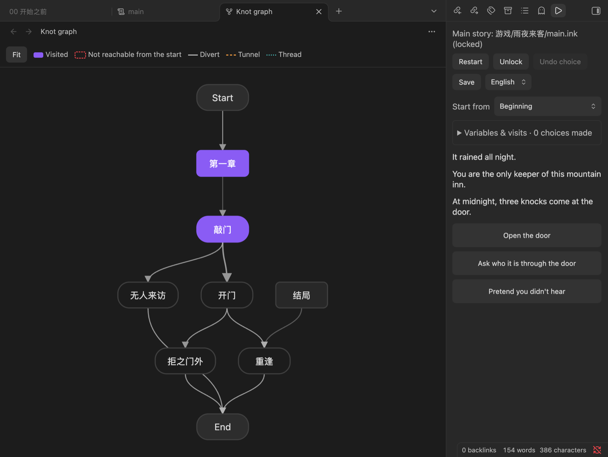

# Inkwright

[](https://github.com/luoxin9510/inkwright/actions/workflows/ci.yml)
[](https://github.com/luoxin9510/inkwright/releases/latest)

**Write, playtest and debug [ink](https://github.com/inkle/ink) interactive fiction in Obsidian.** Works on desktop and mobile. Interface in English and Chinese.

Think of it as Inky inside your vault: your story files sit next to your notes, character sheets and outlines, the play panel recompiles as you type, and the knot graph shows the shape of your branches. When the story is ready, export it as a single web page.

[中文说明](README.zh.md)


## Install

In Obsidian, open **Settings → Community plugins → Browse**, search for **Inkwright**, then install and enable it. Or open the [listing in the community directory](https://community.obsidian.md/plugins/inkwright).

Requires Obsidian 1.13 or later; older versions get the previous release automatically.

## Features

- **Edit `.ink` files** in your vault with syntax highlighting.
- **Play panel**: the story recompiles a moment after you save, so you can play while you write. Undo the last choice, restart, or start from any knot or stitch.
- **Errors you can click**: compile errors and warnings are listed with file and line; click to jump there.
- **Multi-file stories**: `INCLUDE` paths resolve relative to the main story's folder, as in Inky and inklecate. Lock a main story so the panel keeps playing it while you edit its chapters.
- **Variables and visit counts** for the current playthrough.
- **Saves**: save, load and delete progress per story. Saves are stored in the plugin's data, so they sync with your vault.
- **Knot graph**: diverts, tunnels and threads between knots, with knots that can never be reached from the start highlighted.
- **Export as web page**: one self-contained `.html` file next to the story, playable in any browser, with undo and progress kept in the browser. Upload it anywhere (itch.io, GitHub Pages, …).
- **Bilingual stories**: declare `VAR lang = "en"` (or `VAR 语言`) and write text as `{tr("Hello", "你好")}`-style calls; the play panel and exported pages get a language switch that replays the run in the other language without losing progress. Text left outside such a call is reported as a warning.
- **Chinese interface and error messages** (the language follows Obsidian, or can be set in the settings).



## Usage

1. Open a `.ink` file. Click the ▶ ribbon icon (or run **Open play panel**) to play it.
2. For a story split into several files, open the main file and choose **Lock** in the panel (or run **Lock current file as main story**).
3. Run **Open knot graph** to see the story's structure, and **Export as web page** to publish it.

### Bilingual stories

The language variable is set by the panel; the text function is yours, so name it as you like:

```ink
VAR lang = "en"

{tr("It rained all night.", "雨下了整整一夜。")}
* [{tr("Open the door", "开门")}] -> door

=== function tr(en, zh) ===
{ lang == "zh":
    ~ return zh
}
~ return en
```

Languages are `"en"` and `"zh"`. String literals in ink cannot contain `"`, so use `“”` or `'` inside them.

## Agent API

For coding agents and scripts, the plugin exposes `app.plugins.plugins.inkwright.api`, usable through the [Obsidian CLI](https://help.obsidian.md/cli): compile a story, play it headlessly with a list of choices, read variables and visit counts, inspect the knot graph, drive the visible play panel, or export it. Everything returns JSON.

```bash
obsidian eval code='app.plugins.plugins.inkwright.api.help()'
obsidian eval code='app.plugins.plugins.inkwright.api.play("stories/main.ink",{choices:[0,"Open"]}).then(JSON.stringify)'
```

## Privacy

Inkwright makes no network requests. Stories are compiled and played locally with [inkjs](https://github.com/y-lohse/inkjs).

## Development

```bash
npm install
npm test          # unit tests
npm run lint      # Obsidian review rules
npm run build     # type check + bundle main.js
OBSIDIAN_PLUGIN_DIR=/path/to/vault/.obsidian/plugins/inkwright npm run dev   # watch build into a vault
```

Releases are built by GitHub Actions when a version tag (e.g. `0.2.0`, no `v`) is pushed.

## License

MIT. The story engine is [inkjs](https://github.com/y-lohse/inkjs) (MIT); ink is by [inkle](https://www.inklestudios.com/ink/).
