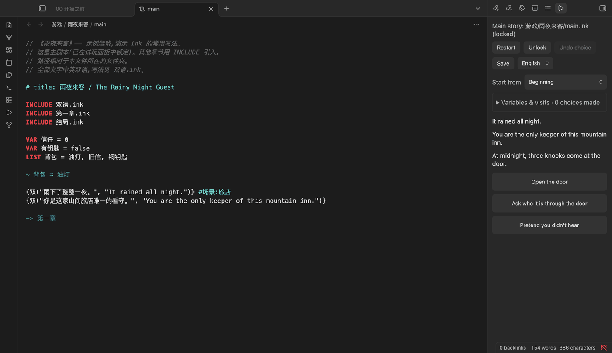
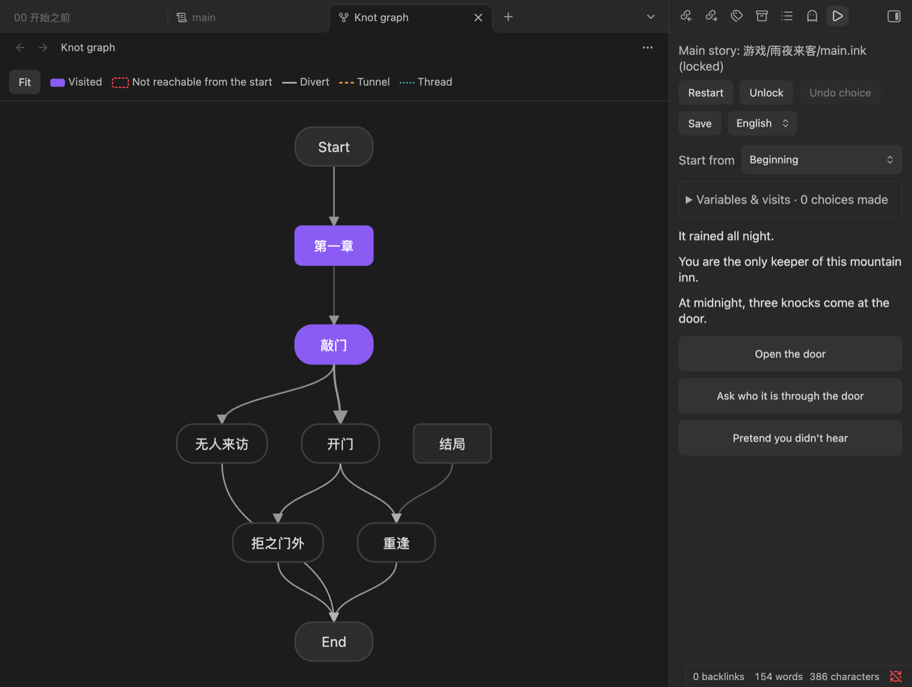

# Inkwright

[](https://github.com/luoxin9510/inkwright/actions/workflows/ci.yml)
[](https://github.com/luoxin9510/inkwright/releases/latest)

**Write, playtest and debug [ink](https://github.com/inkle/ink) interactive fiction in Obsidian.** Works on desktop and mobile. Interface in English and Chinese.

Think of it as Inky inside your vault: your story files sit next to your notes, character sheets and outlines, the play panel recompiles as you type, and the knot graph shows the shape of your branches. When the story is ready, export it as a single web page.

[中文说明](README.zh.md)



## Why Inkwright?

Writing a branching story is already a choose-your-own-adventure. The adventure should not be: alt-tab to Inky, copy the file over, lose the outline, forget which knot you were in, alt-tab back.

- **Your story lives where your notes live.** Character sheets, maps, the timeline, the 3 a.m. plot twist you typed on your phone: all one `[[link]]` away from the script.
- **Write a line, play the line.** Save, and the play panel has already recompiled. No build step, no ceremony.
- **See the spaghetti before your readers do.** The knot graph draws every branch and outlines in red the knots no path can reach. (Every writer has that one perfect ending nobody will ever see.)
- **Works on the train.** Desktop and mobile, same vault, same saves.
- **One file to ship.** Export a single `.html`, drop it on itch.io, go to bed.
- **One story, two languages.** Write `{tr("Hello", "你好")}` once; readers switch languages mid-story without losing their place, and the plugin nags you about untranslated lines more reliably than any editor.
- **Roll the dice.** Put a `game.md` next to a story and it plays as a game: skill checks with odds on the buttons, resources, items, random tables, decks, a map, a dungeon that grows as you explore. Solo tabletop RPGs and gamebooks, written as notes.
- **Robots welcome.** A JSON API lets your coding agent play every ending while you make tea.

```ink
=== you ===
You have a story in your head and a vault full of notes.
* [Keep alt-tabbing between three apps] -> still_alt_tabbing
* [Install Inkwright] -> happily_ever_after
```

## Install

In Obsidian, open **Settings → Community plugins → Browse**, search for **Inkwright**, then install and enable it. Or open the [listing in the community directory](https://community.obsidian.md/plugins/inkwright).

Requires Obsidian 1.13 or later; older versions get the previous release automatically.

## Features

- **Edit `.ink` files** in your vault with syntax highlighting.
- **Play panel**: the story recompiles a moment after you save, so you can play while you write. Undo the last choice, restart, or start from any knot or stitch.
- **Errors you can click**: compile errors and warnings are listed with file and line; click to jump there.
- **Multi-file stories**: `INCLUDE` paths resolve relative to the main story's folder, as in Inky and inklecate. Lock a main story so the panel keeps playing it while you edit its chapters.
- **Variables and visit counts** for the current playthrough.
- **Saves**: save, load and delete progress per story. Saves are stored in the plugin's data, so they sync with your vault.
- **Knot graph**: diverts, tunnels and threads between knots, with knots that can never be reached from the start highlighted.
- **Export as web page**: one self-contained `.html` file next to the story, playable in any browser, with undo and progress kept in the browser. Upload it anywhere (itch.io, GitHub Pages, …).
- **Bilingual stories**: declare `VAR lang = "en"` (or `VAR 语言`) and write text as `{tr("Hello", "你好")}`-style calls; the play panel and exported pages get a language switch that replays the run in the other language without losing progress. Text left outside such a call is reported as a warning.
- **The player writes**: a choice tagged `#input:name` gets a text field; the line typed goes into the `name` VAR (a name, an oath, a diary line), and saves, undo and the language switch keep it.
- **Game mode**: a `game.md` note next to the story turns it into a game with dice checks, skills, resources, characters, items, random tables, decks, hands of cards, a map and more (see [Game mode](#game-mode) below).
- **Playtest at scale**: `npm run check-ink -- <folder> --all` plays every branch (both sides of every check in a game) and reports endings, runtime errors, unreached knots and choices; `--random 300` plays random runs and gives the odds of each ending.
- **Write the session to a note**: in a game, one command turns the run so far (text, choices, dice) into a markdown note.
- **Chinese interface and error messages** (the language follows Obsidian, or can be set in the settings).



## Usage

1. Open a `.ink` file. Click the ▶ ribbon icon (or run **Open player**) to play it in the sidebar, or run **Open player in the main area (full screen)**; a button on the panel's bar moves it between the two.
2. For a story split into several files, open the main file and choose **Lock** in the panel (or run **Lock current file as main story**).
3. Run **Open knot graph** to see the story's structure, and **Export as web page** to publish it.

### Bilingual stories

The language variable is set by the panel; the text function is yours, so name it as you like:

```ink
VAR lang = "en"

{tr("It rained all night.", "雨下了整整一夜。")}
* [{tr("Open the door", "开门")}] -> door

=== function tr(en, zh) ===
{ lang == "zh":
    ~ return zh
}
~ return en
```

Languages are `"en"` and `"zh"`. String literals in ink cannot contain `"`, so use `“”` or `'` inside them.

## Game mode

A folder whose main story sits next to a `game.md` note is a game. The note's frontmatter holds the rules; the story stays plain ink. The state lives in ink variables, so saves, undo, the language switch and the web export all keep working.

```yaml
---
rules: { kind: sum, dice: [6, 6] }          # 2d6 + skill vs difficulty; also rollUnder (d100) and bag (chaos bag)
languages: [zh, en]
skills:
  - { id: insight, name: { zh: 洞察力, en: Insight } }
  - { id: strength, name: { zh: 力量, en: Strength } }
resources:
  - { id: fear, name: { zh: 恐惧, en: Fear }, min: 0, max: 100, initial: 0 }
characters:
  - { id: xin, name: { zh: 昕, en: Xin }, skills: { insight: 3, strength: 2 } }
---
```

Run **Generate game engine ink** to write `_engine.ink` from the note, `INCLUDE` it, and tag choices:

```ink
INCLUDE _engine.ink

* [{t("轻轻推开门", "Ease the door open")} #check:insight:10]
    { check("insight", 10) >= 3:
        {t("门无声地开了。", "It swings open without a sound.")}
    - else:
        {t("门轴发出一声长响。", "The hinge groans.")}
        ~ fear += 20
    }
```

With `languages: [zh, en]` the generated ink declares the language variable and its own `t(zh, en)` helper, so a game does not write a text function of its own.

The player picks a character, sees the odds of each check on the choice, and each roll shows up as a card in the text and in the dice log. The generated ink falls back to plain rules, so the story still runs in Inky.

What a game note can declare:

- **Checks and voices**: `#check:skill:difficulty` on a choice (`:red` for a one-shot check), five result bands from critical failure to critical success, skills that speak up as inner voices (`#voice:skill`), modifiers from resources and items.
- **Resources, characters, companions**: clamped to `min..max`; several playable characters as presets; companions with their own resources.
- **Items**: an inventory list; `#needs:item` locks a choice until the item is carried.
- **Effects**: `#fx:shake|flash|dark|pulse` on a line.
- **Dice and random tables**: `{roll("2d6+3")}`, `d66`, exploding `d6!`; `{table("encounter")}` reads a row from a table written inline or in another note's markdown table.
- **Decks and hands**: `draw("clues")`, `shuffle`, `deck_left`; hands drawn as rows of cards, `#play:hand` plays the picked card. Cards can carry numbers and art and come from a folder of notes.
- **Map**: places, links, hidden places, counters and tokens over an image, or drawn on an Obsidian canvas; `#go:place` makes a place tappable.
- **Growing dungeon**: rooms from a sheet of shapes, hung on free doors as you explore, with secret doors, the way back and notes per room.
- **Party**: several characters played at once, drawn as cards with stat bars.
- **Chaos bag**: checks that draw a token instead of rolling.

The web export carries the engine along, so an exported game plays the same in a browser.

## Agent API

For coding agents and scripts, the plugin exposes `app.plugins.plugins.inkwright.api`, usable through the [Obsidian CLI](https://help.obsidian.md/cli): compile a story, play it headlessly with a list of choices, read variables and visit counts, inspect the knot graph, drive the visible play panel, or export it. Everything returns JSON.

```bash
obsidian eval code='app.plugins.plugins.inkwright.api.help()'
obsidian eval code='app.plugins.plugins.inkwright.api.play("stories/main.ink",{choices:[0,"Open"]}).then(JSON.stringify)'
```

## Privacy

Inkwright makes no network requests. Stories are compiled and played locally with [inkjs](https://github.com/y-lohse/inkjs).

## Development

```bash
npm install
npm test          # unit tests
npm run lint      # Obsidian review rules
npm run build     # type check + bundle main.js
npm run check-ink -- <folder> [--all] [--random N]   # compile and play every story under a folder
npm run export-web -- <main.ink> <out.html>          # web export from the command line
npm run gen-engine -- <main.ink> [--check]           # write (or check) a game's _engine.ink
OBSIDIAN_PLUGIN_DIR=/path/to/vault/.obsidian/plugins/inkwright npm run dev   # watch build into a vault
```

Releases are built by GitHub Actions when a version tag (e.g. `0.2.0`, no `v`) is pushed.

## Thanks

- **[inkle](https://www.inklestudios.com/)**, for creating [ink](https://www.inklestudios.com/ink/) and Inky, open-sourcing them under MIT, and showing with *80 Days*, *Heaven's Vault* and friends what a few `*` and `->` can do. Inkwright is an unofficial fan tool and not affiliated with inkle.
- **[inkjs](https://github.com/y-lohse/inkjs)** by Yannick Lohse and contributors, the JavaScript port of ink that compiles and runs every story here.
- **[Obsidian](https://obsidian.md)**, for a plugin API that lets an interactive fiction studio move into a note-taking app.

## License

MIT. The story engine is [inkjs](https://github.com/y-lohse/inkjs) (MIT); ink is by [inkle](https://www.inklestudios.com/ink/).
