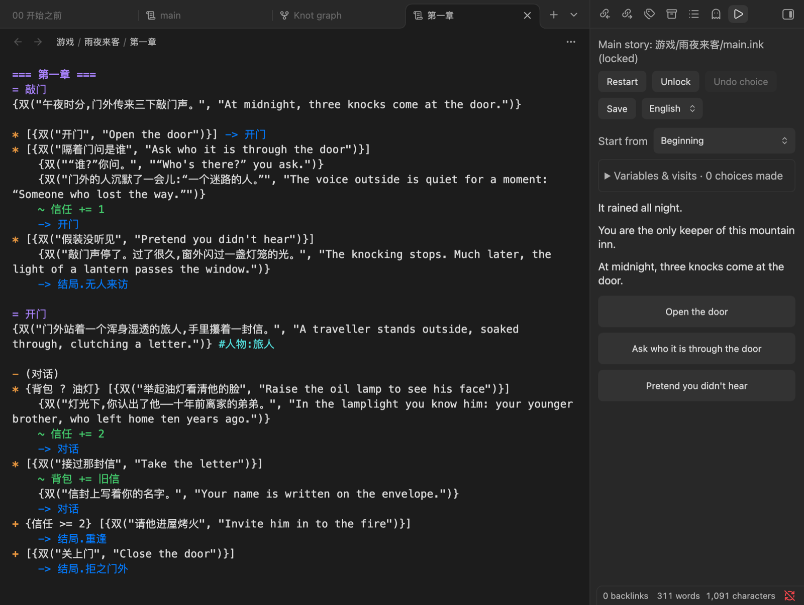

# Inkwright

**Write, playtest and debug [ink](https://github.com/inkle/ink) interactive fiction in Obsidian.** Chinese and English interface.

在 Obsidian 里编写、试玩和调试 [ink](https://github.com/inkle/ink) 互动小说的插件,中英双语界面。桌面端和手机端都能用。[English](README.md)



## 为什么要做 Inkwright

写分支剧情本身就是一场"选择你的冒险"。但冒险的内容不应该是:切到 Inky,复制文件,大纲找不到了,忘了自己写到哪个 knot,再切回来。

- **剧本和笔记住在一起**:人物小传、地图、时间线、凌晨三点在手机上记下的神转折,都和剧本只隔一个 `[[双链]]`。
- **写一句,玩一句**:保存即编译,试玩面板已经替你点好了"重新开始"。
- **剧情是不是一盘意大利面,先给你自己看**:knot 图谱把每条分支画出来,从开头根本走不到的 knot 用红色虚线圈出。每个作者都有一个"永远没人能看到的完美结局"。
- **地铁上也能写**:桌面、手机都能用,同一个 vault,同一份存档。
- **一个文件就能发布**:导出单个 `.html`,扔到 itch.io,然后去睡觉。
- **一份剧本,两种语言**:`{双("你好", "Hello")}` 写一次,读者中途切换语言也不丢进度;漏翻的句子插件会催你,比编辑催稿还准时。
- **报错说人话**:编译错误翻译成中文,点一下就跳到出错的那一行。
- **欢迎 AI 来打工**:给 agent 用的 JSON 接口,它负责把每个结局都跑一遍,你负责喝茶。

```ink
=== 你 ===
脑子里有个故事,vault 里有一堆笔记。
* [继续在三个软件之间反复横跳] -> 结局.拒之门外
* [装上 Inkwright] -> 结局.重逢
```

## 安装

在 Obsidian 里打开 设置 → 第三方插件 → 浏览,搜索 **Inkwright**,安装并启用。也可以打开[社区目录里的页面](https://community.obsidian.md/plugins/inkwright)。

需要 Obsidian 1.13 或更新版本;旧版本会自动装上一个兼容的旧版插件。

## 功能

- 在 vault 里直接打开、编辑 `.ink` 文件,带语法高亮。
- 试玩面板:改动保存后自动重新编译,点击选项推进,可"重新开始"。
- 编译报错显示为中文(未收录的报错保留英文原文),点击报错跳到对应文件和行。
- `INCLUDE` 多文件剧本:路径相对于**主剧本所在文件夹**解析,与 Inky / inklecate 一致。
- 主剧本锁定:锁定后切去编辑任何子文件,试玩面板仍运行主剧本。
- 试玩面板里的变量与访问次数、从任意 knot 开始、存档 / 读档 / 回退一步。
- Knot 图谱:显示跳转关系,标出从开头走不到的 knot。
- 导出为网页:命令"导出为网页"把主剧本导出成一个独立的 `.html`(放在剧本旁边),用浏览器打开就能玩,进度自动保存在浏览器里。
- 界面中英双语(设置里可选)。
- 中英双语游戏:剧本声明 `VAR 语言 = "zh"`,文字写成 `{双("中文", "English")}`;试玩面板和导出的网页都能切换语言,未翻译的行会给出警告。

## 使用

- 打开试玩面板:左侧功能区的 ▶ 图标,或命令"打开试玩面板"。
- 命令"将当前文件锁定为主剧本" / "解除主剧本锁定",或用面板上的按钮。
- 编辑后约 2 秒(Obsidian 自动保存)面板会自动更新,重新编译后故事从头开始。

## 给 agent 用的接口(Agent API)

插件在 Obsidian 里暴露 `app.plugins.plugins.inkwright.api`,可以通过 [Obsidian CLI](https://help.obsidian.md/cli) 的 `eval` 编译剧本、按选项序列自动试玩、读取变量和访问次数、驱动试玩面板,结果都是 JSON:

```bash
obsidian vault=<你的 vault> eval code='app.plugins.plugins.inkwright.api.help()'
obsidian vault=<你的 vault> eval code='app.plugins.plugins.inkwright.api.play("游戏/main.ink",{choices:[0,"开门"]}).then(JSON.stringify)'
```

## 开发

```bash
npm install
npm test          # 单元测试
npm run build     # 类型检查 + 打包出 main.js
OBSIDIAN_PLUGIN_DIR=/path/to/vault/.obsidian/plugins/inkwright npm run dev   # 监听构建,直接输出到 vault
```

## 手动安装到 vault

把 `main.js`、`manifest.json`、`styles.css` 复制到 `<vault>/.obsidian/plugins/inkwright/`,在 Obsidian 设置的"第三方插件"中启用。手机端通过你的 vault 同步方式把这个文件夹同步过去即可。

## 通过 BRAT 安装(桌面和手机)

1. 在社区插件市场安装并启用 **BRAT**(Obsidian42 - BRAT)。
2. BRAT 设置 → "Add Beta plugin",填入 `luoxin9510/inkwright`。
3. 在第三方插件列表里启用"Inkwright"。之后发布新版本时 BRAT 会自动更新。

## 许可证

MIT。剧本引擎使用 [inkjs](https://github.com/y-lohse/inkjs)(MIT)。
