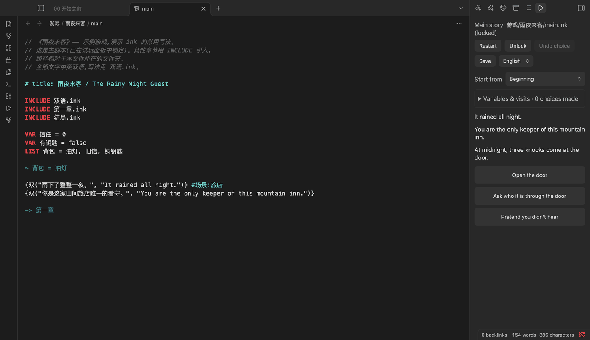

# Inkwright

**Write, playtest and debug [ink](https://github.com/inkle/ink) interactive fiction in Obsidian.** Chinese and English interface.

在 Obsidian 里编写、试玩和调试 [ink](https://github.com/inkle/ink) 互动小说的插件,中英双语界面。桌面端和手机端都能用。[English](README.md)



## 为什么要做 Inkwright

写分支剧情本身就是一场"选择你的冒险"。但冒险的内容不应该是:切到 Inky,复制文件,大纲找不到了,忘了自己写到哪个 knot,再切回来。

- **剧本和笔记住在一起**:人物小传、地图、时间线、凌晨三点在手机上记下的神转折,都和剧本只隔一个 `[[双链]]`。
- **写一句,玩一句**:保存即编译,试玩面板已经替你点好了"重新开始"。
- **剧情是不是一盘意大利面,先给你自己看**:knot 图谱把每条分支画出来,从开头根本走不到的 knot 用红色虚线圈出。每个作者都有一个"永远没人能看到的完美结局"。
- **地铁上也能写**:桌面、手机都能用,同一个 vault,同一份存档。
- **一个文件就能发布**:导出单个 `.html`,扔到 itch.io,然后去睡觉。
- **一份剧本,两种语言**:`{双("你好", "Hello")}` 写一次,读者中途切换语言也不丢进度;漏翻的句子插件会催你,比编辑催稿还准时。
- **报错说人话**:编译错误翻译成中文,点一下就跳到出错的那一行。
- **还能掷骰子**:剧本旁边放一篇 `game.md`,它就成了一个游戏:技能检定(成功率直接标在选项上)、资源、物品、随机表、牌堆、地图、边走边长的地城。单人跑团和游戏书,写成笔记就能玩。
- **欢迎 AI 来打工**:给 agent 用的 JSON 接口,它负责把每个结局都跑一遍,你负责喝茶。

```ink
=== 你 ===
脑子里有个故事,vault 里有一堆笔记。
* [继续在三个软件之间反复横跳] -> 结局.拒之门外
* [装上 Inkwright] -> 结局.重逢
```

## 安装

在 Obsidian 里打开 设置 → 第三方插件 → 浏览,搜索 **Inkwright**,安装并启用。也可以打开[社区目录里的页面](https://community.obsidian.md/plugins/inkwright)。

需要 Obsidian 1.13 或更新版本;旧版本会自动装上一个兼容的旧版插件。

## 功能

- 在 vault 里直接打开、编辑 `.ink` 文件,带语法高亮。
- 试玩面板:改动保存后自动重新编译,点击选项推进,可"重新开始"。
- 编译报错显示为中文(未收录的报错保留英文原文),点击报错跳到对应文件和行。
- `INCLUDE` 多文件剧本:路径相对于**主剧本所在文件夹**解析,与 Inky / inklecate 一致。
- 主剧本锁定:锁定后切去编辑任何子文件,试玩面板仍运行主剧本。
- 试玩面板里的变量与访问次数、从任意 knot 开始、存档 / 读档 / 回退一步。
- Knot 图谱:显示跳转关系,标出从开头走不到的 knot。
- 导出为网页:命令"导出为网页"把主剧本导出成一个独立的 `.html`(放在剧本旁边),用浏览器打开就能玩,进度自动保存在浏览器里。
- 游戏模式:剧本旁边放一篇 `game.md`,就有了掷骰检定、技能、资源、主角、物品、随机表、牌堆、手牌、地图等等(见下面的[游戏模式](#游戏模式))。
- 批量试玩:`npm run check-ink -- <文件夹> --all` 走遍每条分支(游戏里每个检定的成败两面),报告结局、运行时错误、没走到的 knot 和选项;`--random 300` 随机跑三百局,给出每个结局的概率。
- 把这局写成笔记:游戏里一条命令,把当前这局的正文、选择和骰子写成一篇 markdown 笔记。
- 界面中英双语(设置里可选)。
- 中英双语游戏:剧本声明 `VAR 语言 = "zh"`,文字写成 `{双("中文", "English")}`;试玩面板和导出的网页都能切换语言,未翻译的行会给出警告。

## 使用

- 打开试玩面板:左侧功能区的 ▶ 图标,或命令"打开试玩面板";命令"在主区域打开试玩面板(全屏)"在主区域打开,面板顶栏上的按钮可以在侧栏和主区域之间来回移动。
- 命令"将当前文件锁定为主剧本" / "解除主剧本锁定",或用面板上的按钮。
- 编辑后约 2 秒(Obsidian 自动保存)面板会自动更新,重新编译后故事从头开始。

## 游戏模式

主剧本旁边有一篇 `game.md` 笔记的文件夹就是一个游戏。笔记的 frontmatter 是规则,剧本还是普通的 ink。状态都在 ink 变量里,所以存档、回退、切换语言、导出网页都照常工作。

```yaml
---
rules: { kind: sum, dice: [6, 6] }          # 2d6 + 技能 对 难度;另有 rollUnder(d100)和 bag(混沌袋)
languages: [zh, en]
skills:
  - { id: insight, name: { zh: 洞察力, en: Insight } }
  - { id: strength, name: { zh: 力量, en: Strength } }
resources:
  - { id: fear, name: { zh: 恐惧, en: Fear }, min: 0, max: 100, initial: 0 }
characters:
  - { id: xin, name: { zh: 昕, en: Xin }, skills: { insight: 3, strength: 2 } }
---
```

运行命令"生成游戏引擎 ink",从笔记生成 `_engine.ink`,在剧本里 `INCLUDE` 它,再给选项加标签:

```ink
INCLUDE _engine.ink

* [{t("轻轻推开门", "Ease the door open")} #check:insight:10]
    { check("insight", 10) >= 3:
        {t("门无声地开了。", "It swings open without a sound.")}
    - else:
        {t("门轴发出一声长响。", "The hinge groans.")}
        ~ fear += 20
    }
```

配置里写了 `languages: [zh, en]`,生成的 ink 就会声明语言变量和自带的 `t(中文, English)` 函数,游戏不用自己再写文字函数。

玩家先选主角,选项上显示每个检定的成功率,每次掷骰都作为一张卡片出现在正文和骰子日志里。生成的 ink 自带无引擎时的回退规则,所以剧本在 Inky 里也能跑。

`game.md` 能声明的东西:

- **检定与心声**:选项上的 `#check:技能:难度`(加 `:red` 是一次性的红检定),从大失败到大成功五档结果;技能会作为内心的声音插话(`#voice:技能`);资源和物品带来修正。
- **资源、主角、队友**:资源限制在 `min..max` 之内;多个可选主角作为预设;队友有自己的资源。
- **物品**:背包列表;`#needs:物品` 让选项在没带这件东西时锁住。
- **特效**:一行文字加 `#fx:shake|flash|dark|pulse`。
- **骰子与随机表**:`{roll("2d6+3")}`、`d66`、爆骰 `d6!`;`{table("encounter")}` 从表里读一行,表可以写在配置里,也可以是另一篇笔记里的 markdown 表格。
- **牌堆与手牌**:`draw("clues")`、`shuffle`、`deck_left`;手牌画成一排卡片,`#play:hand` 打出选中的牌。牌可以带数值和插图,也可以来自一个文件夹的笔记。
- **地图**:底图上的地点、连线、未揭示的地点、计数和记号,也可以直接用 Obsidian 画布来画;`#go:地点` 让地点可以点击。
- **生长的地图**:房间从一张形状表里取,边探索边挂到空着的门上,带暗门、回程路线和每个房间的笔记。
- **小队**:同时操作好几个角色,画成带数值条的人物卡。
- **混沌袋**:检定时从袋子里抽标记,代替掷骰。

导出网页时引擎一起带走,导出的游戏在浏览器里玩起来和面板里一样。

## 给 agent 用的接口(Agent API)

插件在 Obsidian 里暴露 `app.plugins.plugins.inkwright.api`,可以通过 [Obsidian CLI](https://help.obsidian.md/cli) 的 `eval` 编译剧本、按选项序列自动试玩、读取变量和访问次数、驱动试玩面板,结果都是 JSON:

```bash
obsidian vault=<你的 vault> eval code='app.plugins.plugins.inkwright.api.help()'
obsidian vault=<你的 vault> eval code='app.plugins.plugins.inkwright.api.play("游戏/main.ink",{choices:[0,"开门"]}).then(JSON.stringify)'
```

## 开发

```bash
npm install
npm test          # 单元测试
npm run build     # 类型检查 + 打包出 main.js
npm run check-ink -- <文件夹> [--all] [--random N]   # 编译并试玩文件夹里的每个剧本
npm run export-web -- <main.ink> <out.html>          # 命令行导出网页
npm run gen-engine -- <main.ink> [--check]           # 生成(或检查)游戏的 _engine.ink
OBSIDIAN_PLUGIN_DIR=/path/to/vault/.obsidian/plugins/inkwright npm run dev   # 监听构建,直接输出到 vault
```

## 手动安装到 vault

把 `main.js`、`manifest.json`、`styles.css` 复制到 `<vault>/.obsidian/plugins/inkwright/`,在 Obsidian 设置的"第三方插件"中启用。手机端通过你的 vault 同步方式把这个文件夹同步过去即可。

## 通过 BRAT 安装(桌面和手机)

1. 在社区插件市场安装并启用 **BRAT**(Obsidian42 - BRAT)。
2. BRAT 设置 → "Add Beta plugin",填入 `luoxin9510/inkwright`。
3. 在第三方插件列表里启用"Inkwright"。之后发布新版本时 BRAT 会自动更新。

## 致谢

- **[inkle](https://www.inklestudios.com/)**:感谢他们创造了 [ink](https://www.inklestudios.com/ink/) 和 Inky,并以 MIT 协议开源,还用 *80 Days*、*Heaven's Vault* 等作品证明了几个 `*` 和 `->` 能讲出多好的故事。Inkwright 是爱好者做的非官方工具,与 inkle 没有隶属关系。
- **[inkjs](https://github.com/y-lohse/inkjs)**:Yannick Lohse 和贡献者们做的 ink JavaScript 移植版,本插件里每个剧本都是靠它编译和运行的。
- **[Obsidian](https://obsidian.md)**:它的插件接口让一个互动小说工作室能直接搬进笔记软件里。

## 许可证

MIT。剧本引擎使用 [inkjs](https://github.com/y-lohse/inkjs)(MIT)。
